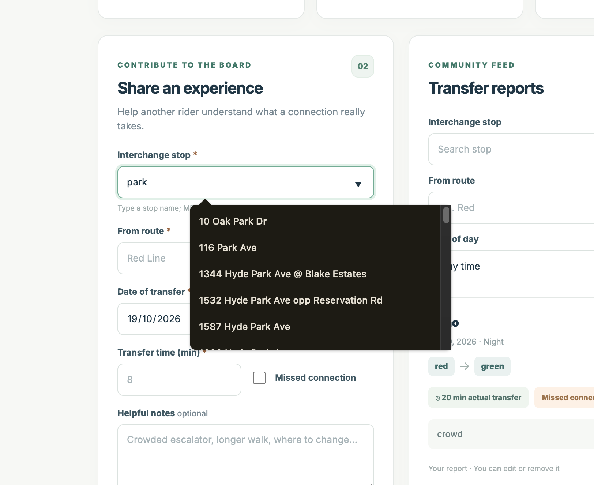

> **Integration status:** This branch includes both Manoj’s commute dashboard and Kavya’s transfer board. PR #1 integrates the transfer feature into `main`; its merge is a separate review step.

# RideTrace Boston

**A full-stack MBTA commute reliability and community transfer-experience app**  
**Authors:** Manoj Harridoss and Kavya Kusuma Reddy Korem  
**Course:** Northeastern University Web Development — Project 2  
**Class reference:** [Instructor's P2 proposal / course Slack thread](https://webdev-online-neu.slack.com/archives/C09DCBJP2BU/p1759790564109799) and [course architecture video](https://www.youtube.com/watch?v=GqW1K1jHJCc&list=PLmRfPZr9-VoHJ6K1g3URENMAVYPXCQFyw&index=30)  
**License:** MIT (application code). MBTA GTFS reference data is provided separately by MBTA / MassDOT and requires attribution.

## Objective and functionality

- **Manoj — Commute Reliability Dashboard** (`commuteLogs`): independently implement full-stack commute CRUD, history search and weekday filtering, weekly delay chart, on-time percentage, average delay, and a personal departure-buffer recommendation. Commute history is accessible only to the browser that created it.
- **Kavya — Transfer Experience Board** (`transferReports`): independently implement full-stack public transfer-report CRUD (owner-only edits/deletions), filtering by stop/routes/daypart, median reported transfer time, missed-connection percentage, and labels for old/unverified reports.
- **Shared reference** (`mbtaStops`): official MBTA GTFS stop/platform records imported as **read-only**. Neither editable module reads or writes the other editable collection. Each feature can be developed and demonstrated on its own.

No React, Mongoose, CommonJS, template engines, or server-side rendering. The frontend is HTML/CSS/Vanilla JS ES modules using the Fetch API. Express and the native MongoDB Node driver power JSON APIs.

## Running application screenshot

This is an actual local-browser screenshot supplied by Manoj on October 19, 2026. It shows MBTA stop suggestions in the transfer entry form; any report values shown are user-entered test data. It is not evidence of public deployment.



## Design mockups

The [design document](docs/DESIGN.md) includes the project description, two rider personas, six independently owned user stories with acceptance criteria, and four annotated design boards.

| Overview                                                                                                                | Manoj’s commute dashboard                                                                                                      |
| ----------------------------------------------------------------------------------------------------------------------- | ------------------------------------------------------------------------------------------------------------------------------ |
| [](docs/mockups/overview-wireframe.png) | [](docs/mockups/commutes-wireframe.png) |

| Kavya’s transfer board                                                                                                            | Responsive layout plan                                                                              |
| --------------------------------------------------------------------------------------------------------------------------------- | --------------------------------------------------------------------------------------------------- |
| [](docs/mockups/transfers-wireframe.png) | [](docs/mockups/mobile-wireframe.png) |

The feature boards include partial local screenshots supplied by Manoj. The overview image is a concept illustration, and the mobile board describes intended behavior rather than completed device testing. See [visual sources and captions](docs/mockups/README.md).

## Requirements

- Node.js **20.12+** and npm
- MongoDB 6+ running locally or a MongoDB Atlas connection
- Internet access **for initial GTFS import only**; the app itself works offline from MBTA after seeding
- Optional: Docker with Docker Compose to start MongoDB locally

## Build and run

From the project root:

```bash
npm install
cp .env.example .env
```

Edit `.env`: set `MONGODB_URI`, `MONGODB_DB` and replace `APP_SECRET` with a **long random secret**. Example generator: `node --input-type=module -e "import { randomBytes } from 'node:crypto'; console.log(randomBytes(32).toString('hex'))"`. **Never commit `.env`.**

Start MongoDB (if using Docker):

```bash
docker compose up -d
```

Then import the MBTA source dataset:

```bash
npm run seed:mbta
```

Alternatively, if you already downloaded the official GTFS archive, import a local ZIP file:

```bash
node --env-file=.env scripts/seed-mbta.js --file=/path/to/MBTA_GTFS.zip
```

Start the application:

```bash
npm start
```

Visit **http://localhost:3000**. The GTFS importer checks that the official feed contains more than 1,000 valid stop/platform records before updating the catalog, and prints the number actually imported. It does **not** create fake transit records. If the MBTA URL is temporarily unavailable, download the same ZIP from https://cdn.mbta.com/MBTA_GTFS.zip and use `--file=`.

### Use the app

1. **Overview:** pick either the personal commute dashboard or the community board.
2. **My commutes:** enter route, date, expected/actual minutes, reason and optional notes; save. After at least three trips, the dashboard shows a suggested departure buffer. Filter trips or use Edit/Delete in the table.
3. **Transfer board:** enter a stop, two routes, date/daypart, actual minutes, whether you missed the connection and optional notes. Submit. Use filters to find other riders' experiences; you can Edit/Delete reports created in the same browser.
4. **Guide:** read privacy, calculation and data disclaimers.

**Privacy limitation:** browser identity is a signed HttpOnly cookie, not a user account. Clearing cookies may make the user's previous records inaccessible. Transfer reports are publicly readable, and reports are explicitly unverified. Do not enter personal information in public reports. It is not a real-time status or emergency service.

### Important details about statistics

- **Positive delay** = `max(0, actualMinutes - expectedMinutes)`.
- **On-time** = a journey that is no more than two minutes later than expected, including early arrivals.
- **Departure buffer** = the nearest-rank 80th percentile of non-negative delays rounded **up** to the nearest five minutes, shown only after three logs. It is a heuristic, not a live prediction.
- **Typical transfer time** = median of report durations matching current filters.
- Statistics use at most the most recent 2,500 matching reports/logs for predictable server workloads. The corresponding endpoints return `maximumAnalyzed`.

## Team feature ownership and GitHub

This project is structured as **one shared repository with separate full-stack feature folders**:

| Owner                                     | Express route                     | HTML / JS / CSS | Tests                           | MongoDB collection |
| ----------------------------------------- | --------------------------------- | --------------- | ------------------------------- | ------------------ |
| Manoj Harridoss (`@Manojh23`)             | `src/features/manoj/commutes.js`  | `public/manoj/` | `tests/manoj-commutes.test.js`  | `commuteLogs`      |
| Kavya Kusuma Reddy Korem (`@kavya-korem`) | `src/features/kavya/transfers.js` | `public/kavya/` | `tests/kavya-transfers.test.js` | `transferReports`  |

Shared infrastructure remains in `src/lib/`, `src/auth/`, `src/db/`, `public/js/api.js`, `src/routes/stops.js`, and the app server. See [GitHub Setup](docs/GITHUB_SETUP.md) and [Claude Code Notes](CLAUDE.md). The feature ownership labels describe full-stack responsibilities; Git history records individual commits.

**Page URLs:** `/manoj/` and `/kavya/` (plus `/` for the shared home page and `/guide.html` for usage instructions).

## API summary

| Endpoint                | Methods     | Access                                    |
| ----------------------- | ----------- | ----------------------------------------- |
| `/api/health`           | GET         | Database health                           |
| `/api/stops?search=...` | GET         | Read-only public MBTA stop lookup         |
| `/api/commutes`         | GET, POST   | Only the current signed anonymous browser |
| `/api/commutes/stats`   | GET         | Private statistics                        |
| `/api/commutes/:id`     | PUT, DELETE | Only original browser                     |
| `/api/transfers`        | GET, POST   | Public reads; anonymous posts             |
| `/api/transfers/stats`  | GET         | Public aggregate statistics               |
| `/api/transfers/:id`    | PUT, DELETE | Only original browser                     |

All create/update endpoints use JSON and validate input on the server. Pagination is bounded; user-provided filters are regex-escaped. Report responses do not expose raw owner IDs, and records render through safe DOM text APIs (not HTML injection).

## Testing and formatting

```bash
npm test
npm run lint
npm run format:check
npm run verify
```

The `eslint.config.js` file uses ESLint flat config, and `.prettierrc.json` provides Prettier settings. **Verification on 2026-10-19:** all **16 automated tests**, ESLint, Prettier, and syntax checks for all **25 JavaScript files** pass after the integration fixes. Two regression tests exercise the actual frontend modules with a minimal DOM and mock API, including deletion of the only record on the last page. These tests do not simulate CSS layout or a live MongoDB server.

**Manoj’s local browser evidence:** create/read/update/delete, refresh persistence, displayed statistics, and private-commute/public-transfer behavior across normal and incognito windows were reported working. A terminal screenshot confirms **8,035 imported MBTA stop records**, and a browser screenshot confirms stop suggestions. This evidence is from Manoj’s local environment, not an independently repeated integration run here.

**Still pending:** full filter/invalid-input coverage, real mobile/keyboard checks, public deployment and production-database verification, professor approval and course deliverables. See [testing instructions](docs/TESTING.md) and the [rubric audit](docs/RUBRIC_AUDIT.md).

## Production deployment

Deploy to any Node-compatible public host with an accessible MongoDB Atlas cluster. Set `MONGODB_URI`, `MONGODB_DB`, `APP_SECRET` (32+ random chars), `NODE_ENV=production`, and the platform-provided `PORT` in the host environment. Use **`node src/server.js`** as the host start command (production uses host environment variables, not a local `.env`). Import GTFS once using a network-enabled terminal with the same DB credentials. Enable TLS/HTTPS so secure cookies work and limit database network access. Do not commit credentials or a real `.env` file.

Public deployment is a separate step requiring a Node-compatible hosting account and an accessible MongoDB database. Likewise, the course Google Form, narrated public demo, code freeze, and professor code review must be completed by the team. See [Rubric Audit](docs/RUBRIC_AUDIT.md) for evidence and outstanding items.

## Data source and attribution

Official feed: **https://cdn.mbta.com/MBTA_GTFS.zip**. Documentation: https://github.com/mbta/gtfs-documentation/blob/master/reference/gtfs.md. **Data provided by the MBTA / MassDOT.** This project is independent and not endorsed by the MBTA. Source data belongs to its respective provider and is not covered by this repository's MIT license.

## AI-use disclosure

Generative AI assisted with MBTA resource research, planning, starter code, tests, and documentation. Each teammate is responsible for reviewing, understanding, testing, and explaining their assigned feature.
