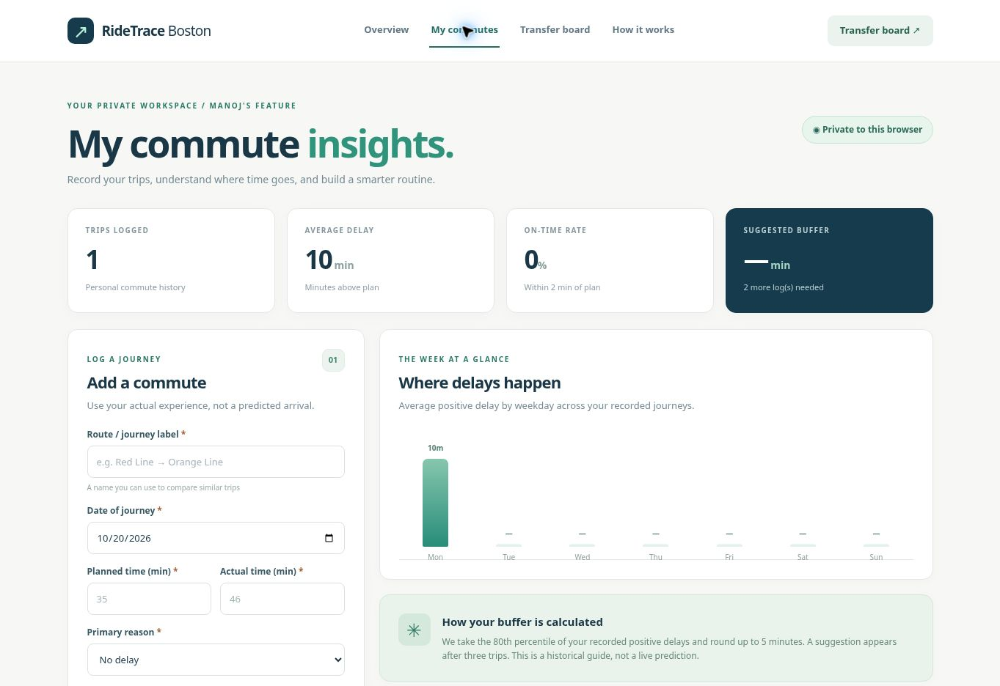
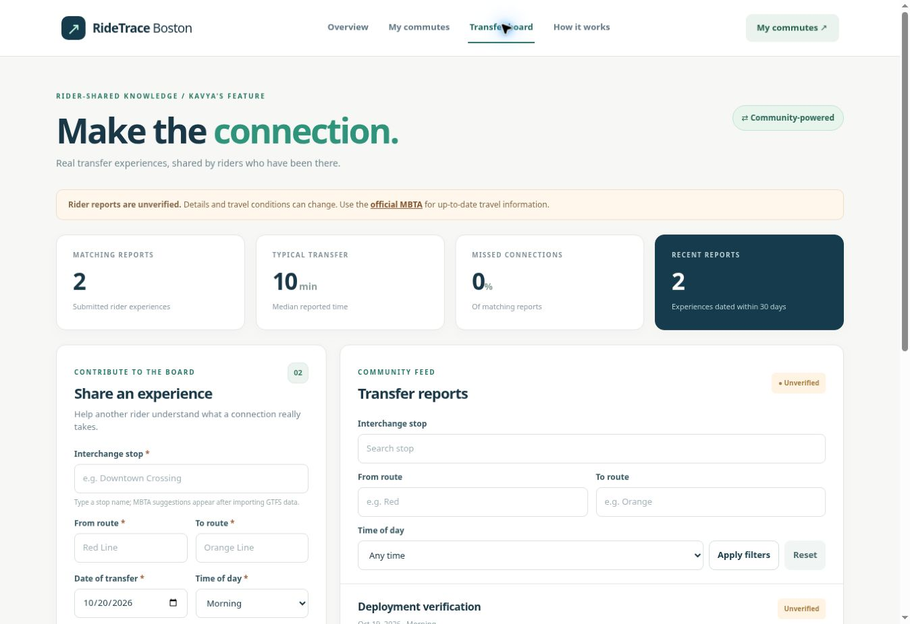

# RideTrace Boston

A web app for tracking MBTA commute delays and sharing transfer experiences.

**Authors:** Manoj Harridoss (`@Manojh23`) and Kavya Kusuma Reddy Korem (`@kavya-korem`)  
**Course:** CS5610 Web Development — Project 2  
**Class links:** [Course project thread](https://webdev-online-neu.slack.com/archives/C09DCBJP2BU/p1759790564109799) · [Architecture video](https://www.youtube.com/watch?v=GqW1K1jHJCc&list=PLmRfPZr9-VoHJ6K1g3URENMAVYPXCQFyw&index=30)  
**License:** [MIT](LICENSE)

## Project objective

RideTrace helps riders compare planned and actual travel times and learn from other riders’ transfers. It has two separate full-stack features:

- **Manoj’s commute dashboard:** private journey logs, route and weekday filters, delay statistics, and a suggested departure buffer.
- **Kavya’s transfer board:** public transfer reports, stop/route/time filters, median transfer times, and owner-only editing and deletion.

The app uses Node.js, Express, the native MongoDB driver, and vanilla JavaScript ES modules. Both features share the server and database connection but use separate editable collections.

## Live screenshots

| Manoj’s commute dashboard                                                                                             | Kavya’s transfer board                                                                                               |
| --------------------------------------------------------------------------------------------------------------------- | -------------------------------------------------------------------------------------------------------------------- |
| [](docs/screenshots/commutes-live-20261020.jpg) | [](docs/screenshots/transfers-live-20261020.jpg) |

## Design document

[Read the design document](docs/DESIGN.md) for the project description, personas, user stories, feature ownership, wireframes, and live screenshots.

## Build and run

Requirements: Node.js 20.12+, npm, and MongoDB 6+ or MongoDB Atlas. Docker is optional.

```bash
npm ci
cp .env.example .env
```

Set these values in `.env`:

- `MONGODB_URI`: MongoDB connection string.
- `MONGODB_DB`: database name; default `ridetrace_boston`.
- `APP_SECRET`: a random secret of at least 32 characters.
- `PORT`: app port; default `3000`.

Generate a secret with:

```bash
node --input-type=module -e "import { randomBytes } from 'node:crypto'; console.log(randomBytes(32).toString('hex'))"
```

For the included Docker MongoDB setup:

```bash
docker compose up -d
```

Skip that command if MongoDB is already running locally or in Atlas. The app connects to the database specified in `.env`. Keep `.env` and credentials out of Git.

Import the official stop catalog, then start the app:

```bash
npm run seed:mbta
npm run dev
```

The importer downloads [MBTA GTFS data](https://cdn.mbta.com/MBTA_GTFS.zip), checks for more than 1,000 stop/platform records, and prints the imported count. Manoj’s local import contained 8,035 records. A downloaded archive can also be imported with `node --env-file=.env scripts/seed-mbta.js --file=/path/to/MBTA_GTFS.zip`.

## Using the app

| Page           | Address                          | Main actions                                            |
| -------------- | -------------------------------- | ------------------------------------------------------- |
| Overview       | http://localhost:3000/           | Open either feature                                     |
| My commutes    | http://localhost:3000/manoj/     | Add, filter, edit, or delete private journeys           |
| Transfer board | http://localhost:3000/kavya/     | Browse reports, publish one, or change your own reports |
| How it works   | http://localhost:3000/guide.html | Read calculation and privacy details                    |

Commute history belongs to an anonymous browser identity stored in a signed cookie. Clearing cookies may make earlier records inaccessible. Transfer reports are public, but only the original browser can edit or delete them. Reports are unverified and are not live MBTA predictions.

The commute buffer uses the nearest-rank 80th percentile of non-negative delays, rounded up to five minutes, after at least three logs. On-time means no more than two minutes late. Transfer statistics show the median duration and missed-connection percentage for matching reports. Statistics analyze up to the latest 2,500 matching records.

## Project structure

| Location                               | Contents                                                                                     |
| -------------------------------------- | -------------------------------------------------------------------------------------------- |
| `public/manoj/`, `src/features/manoj/` | Manoj’s HTML, CSS, JavaScript, API, validation, and statistics; `commuteLogs` collection     |
| `public/kavya/`, `src/features/kavya/` | Kavya’s HTML, CSS, JavaScript, API, validation, and statistics; `transferReports` collection |
| `src/db/`, `src/auth/`, `src/lib/`     | Shared database connection, browser identity, and helpers                                    |
| `src/routes/stops.js`, `scripts/`      | Read-only `mbtaStops` lookup and GTFS importer                                               |
| `tests/`                               | Validation, statistics, and frontend pagination tests                                        |
| `docs/`                                | Design document, mockups, and screenshots                                                    |

## Tests and formatting

```bash
npm run verify
```

This runs 25 tests, ESLint, and Prettier. Tests cover validation, statistics, pagination, session startup, connection reuse, and the hosted HTTP entry point. The automated suite uses mock database and DOM implementations. Individual commands are `npm test`, `npm run lint`, and `npm run format:check`.

## Hosting

The repository includes Vercel’s Express preset in `vercel.json`. Vercel uses the default Express export in `src/app.js` for the API and serves `public/` through its CDN. The frontend starts a browser session before making parallel API requests. MongoDB connections are reused within each function instance.

| Host environment variable | Value                                            |
| ------------------------- | ------------------------------------------------ |
| `MONGODB_URI`             | Atlas connection string, stored as a secret      |
| `MONGODB_DB`              | Hosted database name, such as `ridetrace_boston` |
| `APP_SECRET`              | A stable random secret of at least 32 characters |
| `NODE_ENV`                | `production`                                     |

The deployed app reads these values on the server. The frontend calls the Express API and receives JSON, without receiving the Atlas connection string or application secret. `.env` files are excluded from Git.

Both features use the Atlas database `ridetrace_boston`. Manoj’s records use `commuteLogs`, Kavya’s reports use `transferReports`, and the read-only `mbtaStops` catalog provides official stop-name suggestions. The catalog contains more than 1,000 documents. User-created commute and transfer records are separate from the reference data.

The public website is [RideTrace Boston](https://ridetrace-boston.vercel.app). The deployment uses Vercel’s Express preset and a reusable MongoDB connection. Local development uses `npm start`.

## Data source and attribution

Stop data: [MBTA / MassDOT GTFS feed](https://cdn.mbta.com/MBTA_GTFS.zip) and [MBTA GTFS documentation](https://github.com/mbta/gtfs-documentation/blob/master/reference/gtfs.md). Data rights remain with the provider. The MIT license covers application code. RideTrace is not affiliated with the MBTA.

## Video

**Video link:** <https://www.youtube.com/watch?v=-IYju-o7Pzo>


## AI-use disclosure

AI assistance was used for research, brainstorming, and project planning. All implementation, testing, and documentation were completed independently by the team. 
