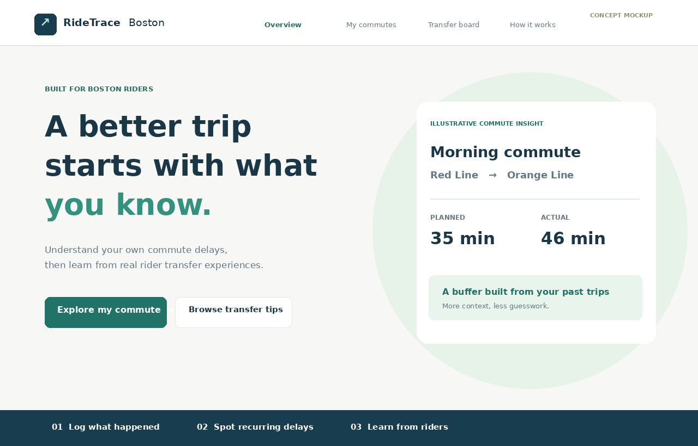
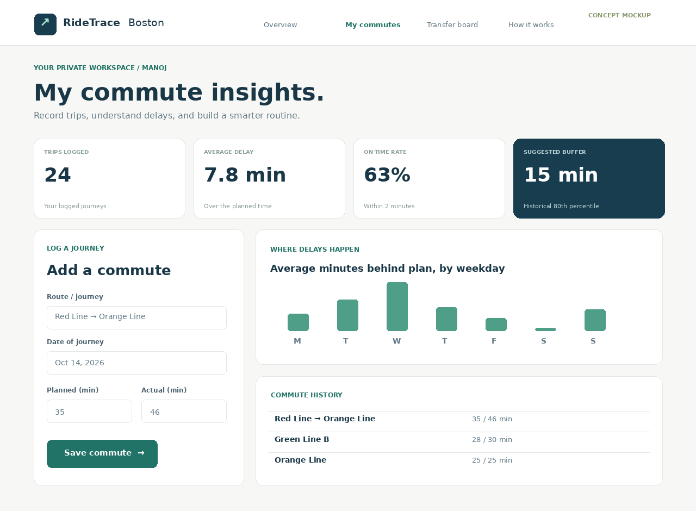
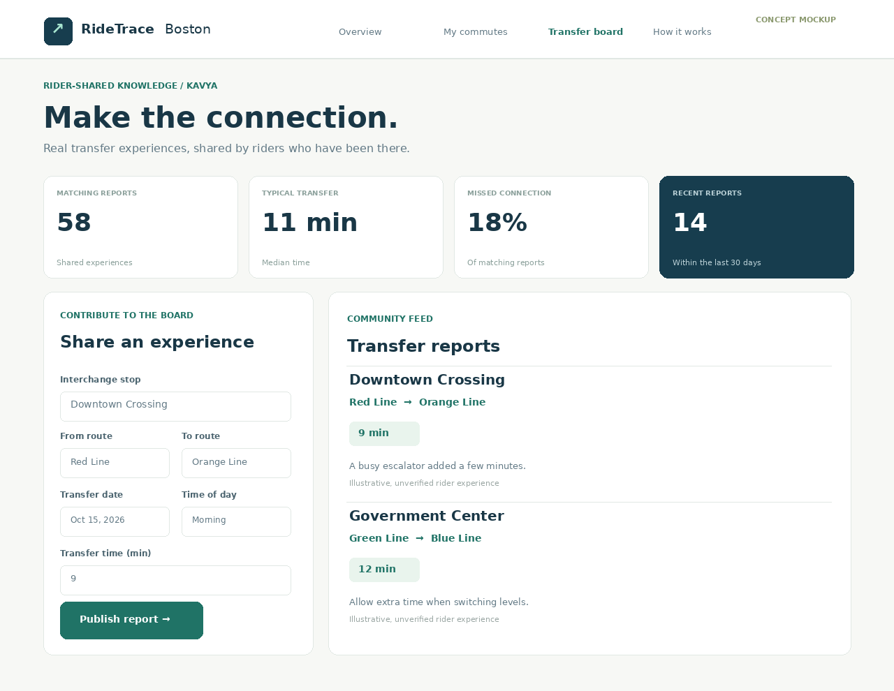

# Design Document — RideTrace Boston

**Team:** Manoj Harridoss and Kavya Kusuma Reddy Korem  
**Project:** RideTrace Boston — Understand commute delays and make more reliable transit connections.  
**Status:** Implemented in source; screens below are illustrative design mockups, not live application screenshots.

## Project description and justification

RideTrace Boston is a practical personal-and-community web application for MBTA riders who want more context than real-time predictions alone. Riders record how long their commutes were expected to take versus the actual time, and the application reveals historical weekday delay patterns, on-time percentages, and a transparent departure-buffer suggestion. Independently, users publish unverified transfer experiences so others can compare reported transfer times by interchange stop, connecting route, and time of day. The features solve different problems and use separate CRUD collections; neither feature depends on the other teammate's implementation. A shared read-only MBTA GTFS stop catalog helps users find stop names, while all statistics remain explicitly historical rather than official forecasts.

## User personas

- **Maya, a student commuter:** Maya rides the T to university several days a week. She consults arrival apps but still cannot tell how many extra minutes recurring delays may cost. She wants to log journeys, compare them with her planned times, and plan with a personal buffer.
- **Daniel, a bus-and-train commuter:** Daniel sometimes misses transfers because the walk or platform wait was longer than he expected. He wants to see other riders' recent experiences with particular connecting routes and share observations of his own.

## User stories, implementation ownership and acceptance criteria

### Manoj — `commuteLogs`

1. **As Maya, I want to create a commute log** with route, date, expected minutes, actual minutes, delay reason, and notes **so I can track journey reliability.**  
   _Acceptance:_ A validated form creates a document via an Express POST route and immediately refreshes the private history.
2. **As Maya, I want to browse, filter, edit and delete commute logs** by route and weekday **so I can maintain an accurate history.**  
   _Acceptance:_ Pagination/filtering work, editing saves changes, deletion confirms, and a different browser cannot read or modify private logs.
3. **As Maya, I want average delays, on-time percentage, weekday patterns and a suggested departure buffer** based on my entries **so I can decide when to leave.**  
   _Acceptance:_ Statistics reflect only my entries, show empty states, and with fewer than three logs no buffer is asserted.

### Kavya — `transferReports`

4. **As Daniel, I want to submit, browse and filter transfer reports** by interchange stop, connecting routes and time of day, including actual transfer minutes, missed connections and notes, **so I can share experiences and plan transfers.**  
   _Acceptance:_ A validated form publishes a public report; filters, date labels, typical transfer median, and missed-connection percentage match the submitted data.
5. **As Daniel, I want to edit or delete my own reports** **so I can correct outdated information.**  
   _Acceptance:_ Author-only controls appear for original browser and server routes reject edits or deletes from another browser.

> The combined user story #4 preserves the previously discussed create + browse/filter functionality. The work remains separate across teammates: commute logs never query transferReports; transfer reports never query commuteLogs.

## Architecture and data design

```
Browser (HTML5, CSS modules, Vanilla ES6 modules, Fetch)
   |-- /commutes.html --> /api/commutes --> MongoDB: commuteLogs (private, Manoj)
   |-- /transfers.html --> /api/transfers --> MongoDB: transferReports (public, Kavya)
   |-- stops autocomplete --> /api/stops --> MongoDB: mbtaStops (read-only)
                                        ^
                     official MBTA GTFS static ZIP importer (one-time script)
```

- **Browser identity:** 16 random bytes identified by a signed HMAC cookie, HttpOnly and SameSite=Lax (Secure when NODE_ENV=production). Ownership restrictions are checked on the server, not via UI alone. The anonymous model has no recovery mechanism after cookie loss.
- **Commute document:** `_id`, `ownerId`, `route`, `date`, `expectedMinutes`, `actualMinutes`, `delayReason`, `notes`, `createdAt`, `updatedAt`.
- **Transfer document:** `_id`, `ownerId`, `stopName`, `fromRoute`, `toRoute`, `observedAt`, `daypart`, `transferMinutes`, `missedConnection`, `notes`, `createdAt`, `updatedAt`.
- **Stop document:** `stopId`, `stopName`, `locationType`, `parentStation`, `latitude`, `longitude` (from MBTA GTFS). The catalog is read-only to web users and refreshed only via the seed script.
- **Technology:** Node ES modules, Express, MongoDB native Node driver, Fetch API and Vanilla JavaScript DOM rendering. The backend does not use `require`, Mongoose, React, or template engines.

## Usability and UI decisions

- Required and optional fields explicitly labeled; proper `input`, `select`, `textarea`, `button` and `table` elements.
- Clear information architecture: Overview, My commutes, Transfer board, How it works.
- Search, filtering, pagination, inline notices, validation errors, edit cancellation, deletion confirmation.
- Data designed for screen readers with semantic headings, `aria-live` notices, field labels, and keyboard focus states.
- Phone/tablet layouts adapt to small widths; no third-party frontend library needed.
- No false real-time arrival claims; reports prominently marked unverified and >30-day observations labeled old.

## Design mockups

These PNGs are **planning illustrations containing example data**; they are not deployed screenshots. Their concepts correspond to actual HTML/CSS pages delivered in `public/`.

### Overview



### Manoj — Commute dashboard



### Kavya — Transfer board



## Limitations and scope

RideTrace is not a timetable, live journey planner, MBTA disruption service or verified safety information. Statistics describe historical, self-reported data and can be misleading if few or unrepresentative records exist. Public transfer reports may be inaccurate and should not be used as official accessibility guidance. The MBTA dataset's license/attribution conditions are separate from the MIT license applied to application code. User authentication is intentionally anonymous to avoid additional external libraries and account complexity; cookie loss prevents recovery of owned entries.

## Testing strategy and acceptance checklist

1. Run `npm test` and syntax checks for statistical calculations, validation, CSV/ZIP parsing, anonymous visitor cookies.
2. With MongoDB running, create two browser sessions; verify each sees only its own commute logs; test cross-session edit/delete returns 404.
3. Verify transfer reports are publicly readable but editing/deleting remains owner-only.
4. Create, update, search/filter, paginate and delete records on both modules.
5. Run GTFS importer and confirm `db.mbtaStops.countDocuments()` is **over 1,000**.
6. Run `npm run lint` and `npm run format:check` after installing dependencies.
7. Check keyboard and mobile layout on real browsers, deploy publicly, verify URL, record narrated demonstration, and complete required instructor review.

## Attribution / AI disclosure

Data courtesy MBTA / MassDOT (https://cdn.mbta.com/MBTA_GTFS.zip). Generative AI assisted with proposal refinement, code generation, design-document preparation, and tests. Manoj and Kavya should independently review, explain, test and own the submitted work.
