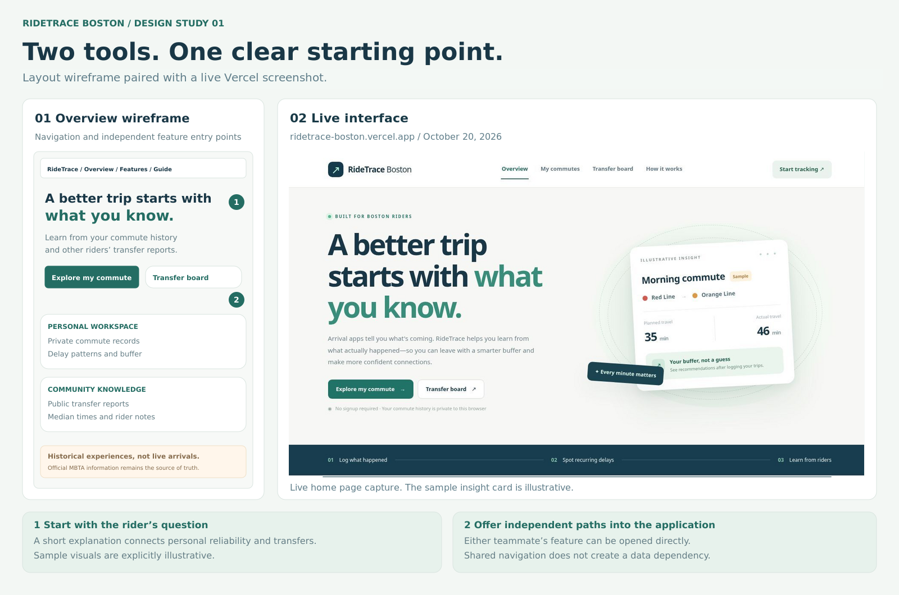
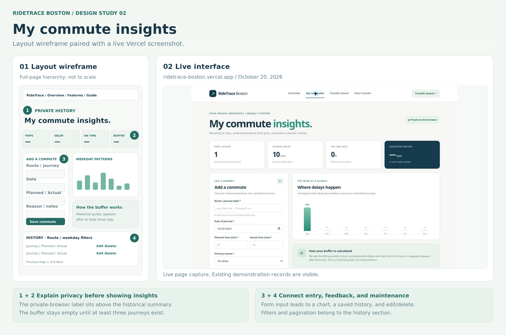
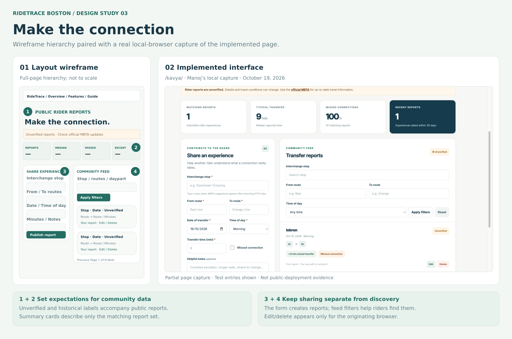
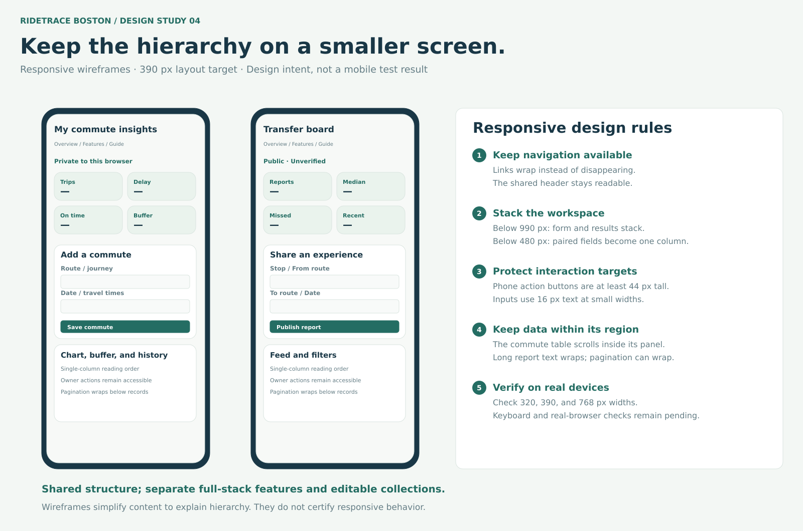

# RideTrace Boston — Design Document

**Team:** Manoj Harridoss and Kavya Kusuma Reddy Korem  
**Course:** CS5610 — Project 2  
**Date:** October 20, 2026

## 1. Project description

RideTrace Boston helps MBTA riders understand their commute delays and share transfer experiences. Riders can save planned and actual travel times in a private dashboard and review delay patterns by weekday. A separate public board lets riders share and search reports about connections between routes. The app uses official MBTA stop data for stop-name suggestions. These tools provide historical information rather than live arrival predictions.

Manoj’s feature answers, “How much extra time do my trips usually need?” Kavya’s feature answers, “What have other riders experienced at this connection?” Reports are self-reported and unverified.

## 2. User personas

These are fictional riders used to guide the design.

### Maya — student commuter

- **Situation:** Takes the T to university several mornings each week.
- **Problem:** Her journey often takes longer than planned, making it hard to decide when to leave.
- **Goal:** Track delays and use her own history to plan a time buffer.
- **Needs:** A quick entry form, private records, and clear statistics.

**Example:** Maya plans a 35-minute trip that takes 46 minutes. She records it after class. After several journeys, she checks weekday patterns and the suggested buffer. If she entered the wrong duration, she can edit the record.

### Daniel — connecting-route commuter

- **Situation:** Uses buses and trains and sometimes makes unfamiliar transfers.
- **Problem:** A connection may involve more walking or waiting than he expected.
- **Goal:** Find relevant rider reports and share his own experience.
- **Needs:** Filters for stop, routes, and time of day; report dates; and clear ownership controls.

**Example:** Daniel searches for evening Red-to-Orange transfers at Downtown Crossing. After his trip, he posts the time it took and whether he missed the connection. He can later correct or delete his report in the same browser.

## 3. User stories

### Manoj — Commute Reliability Dashboard

- **M1:** As Maya, I want to save my route, date, planned and actual minutes, delay reason, and notes so I can track my journeys.
- **M2:** As Maya, I want to browse, filter, edit, and delete my logs so my private history stays accurate.
- **M3:** As Maya, I want delay statistics, weekday patterns, and a buffer estimate so I can plan when to leave.

| Story | Expected behavior                                                                                                                                                         |
| ----- | ------------------------------------------------------------------------------------------------------------------------------------------------------------------------- |
| M1    | Valid entries are saved in MongoDB and remain after refresh. Required fields and invalid durations are checked.                                                           |
| M2    | Route and weekday filters narrow the history. Edits and deletions update the records. Pagination handles the last page. Another browser cannot read or change these logs. |
| M3    | Statistics use the owner’s journeys. The buffer appears after at least three logs and is explained in the interface.                                                      |

### Kavya — Transfer Experience Board

- **K1:** As Daniel, I want to publish a transfer report with stop, routes, date, time of day, duration, and notes so other riders can learn from it.
- **K2:** As Daniel, I want to filter public reports by stop, routes, and time of day so I can find relevant connections.
- **K3:** As Daniel, I want to edit or delete my own reports so I can correct mistakes or remove an entry.

| Story | Expected behavior                                                                                                                     |
| ----- | ------------------------------------------------------------------------------------------------------------------------------------- |
| K1    | Valid reports are saved in MongoDB and appear publicly. MBTA stop suggestions use the imported reference catalog.                     |
| K2    | Filters update the feed and matching statistics. Reports show dates, transfer times, and unverified labels. Older reports are marked. |
| K3    | Only the originating browser sees owner controls. The backend also checks ownership for updates and deletions.                        |

### Feature ownership

| Owner | Frontend        | Backend               | Collection        |
| ----- | --------------- | --------------------- | ----------------- |
| Manoj | `public/manoj/` | `src/features/manoj/` | `commuteLogs`     |
| Kavya | `public/kavya/` | `src/features/kavya/` | `transferReports` |

Each teammate’s feature includes its own frontend, API routes, validation, statistics, and CRUD operations. The features share the server, database connection, browser identity, and common styles. Neither feature reads or writes the other feature’s editable collection. The `mbtaStops` collection is a shared, read-only reference catalog.

## 4. Design mockups

The desktop boards pair the original layout wireframes with screenshots captured from the public Vercel app on October 20, 2026. The dashboard screenshots show existing demonstration records. The mobile board remains a layout wireframe.

### Overview

The home page explains the app and links directly to either feature. Shared navigation also links to the usage guide.

### Manoj’s commute dashboard

The page places private-history information and summary cards first. Below them are the entry form, weekday chart, buffer explanation, and history table. The history includes filters and Edit/Delete controls.

### Kavya’s transfer board

The page shows the unverified-report notice and statistics above the form and public feed. Entry fields and feed filters are separate. Reports show dates, routes, durations, and owner controls where allowed.

### Mobile layout

On narrower screens, the workspace stacks vertically and navigation wraps. Form fields become one column on small phones. The commute table can scroll inside its panel, and long report text wraps. The mobile board illustrates this responsive layout.

### Common design choices

- Navy headings and teal buttons give both features the same visual style.
- Separate panels distinguish entry forms, statistics, and saved records.
- Labels include units and identify required fields.
- Standard buttons, forms, links, and tables support normal browser behavior.
- Text notices explain saved changes, errors, privacy, and unverified reports.

## 5. Technical notes

The frontend uses HTML, CSS, and vanilla JavaScript ES modules. Fetch requests exchange JSON with Express routes. The backend uses the native MongoDB driver.

Commute history uses a signed anonymous browser cookie. Losing that cookie can make old private records inaccessible. Transfer reports remain public, while edits and deletions require the original browser identity.

The buffer is the nearest-rank 80th percentile of non-negative commute delays, rounded up to five minutes, after at least three logs. Transfer statistics use the median duration and percentage of missed connections. Statistics analyze up to 2,500 matching records.

## 6. Sources

Stop data is from [MBTA / MassDOT](https://cdn.mbta.com/MBTA_GTFS.zip). The app is independent of the MBTA. Application code uses the MIT license.

[AI-use disclosure](../README.md#ai-use-disclosure)
